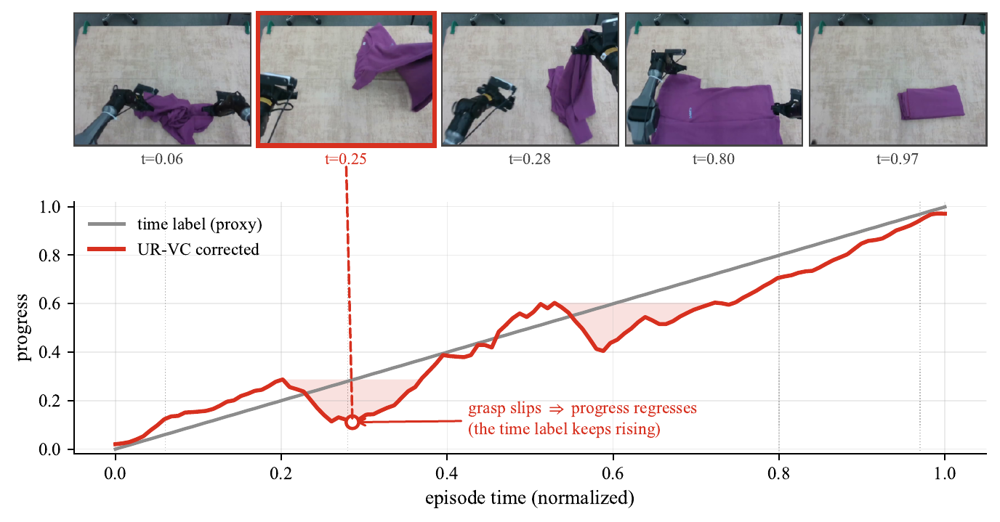

<div align="center">

# UR-VC

### Unsupervised Robotic Value Correction for Time-Derived Progress Proxies

**Time is not progress.**

[Lirui Zhao](https://liruizhao.com/) ·
[Modi Shi](https://modishi.github.io/) ·
[Li Chen](https://ilnehc.github.io/) ·
[Qi Liu](https://leuchine.github.io/) ·
[Ping Luo](https://luoping.me/) ·
[Hongyang Li](https://www.hongyang.li/)

The University of Hong Kong

[](https://arxiv.org/abs/2607.12892)
[](https://liruizhao.com/projects/UR-VC/)
[](LICENSE)

</div>

<p align="center">
  
</p>

UR-VC is an offline, training-free method that corrects normalized-time
progress using recurring visual states across demonstrations. For each frame,
it selects at most one similar frame from each other episode and averages
their time-derived labels. No manual progress labels or additional value model
are required.

## Quick Start

The small example includes **three complete episodes (3,009 frames)**, all
three camera views, and precomputed SigLIP 2 giant embeddings. It runs on CPU
without downloading a model. The commands below target Linux and Python 3.11.

```bash
git clone https://github.com/Lirui-Zhao/UR-VC.git
cd UR-VC
python3.11 -m venv .venv
source .venv/bin/activate
python -m pip install torch==2.7.1 --index-url https://download.pytorch.org/whl/cpu
python -m pip install -c requirements-tested.txt -e ".[visualize]"

mkdir -p data
curl -fL https://github.com/Lirui-Zhao/UR-VC/releases/download/v0.1.0/UR-VC-mini.tar.gz -o data/UR-VC-mini.tar.gz
curl -fL https://github.com/Lirui-Zhao/UR-VC/releases/download/v0.1.0/SHA256SUMS -o data/SHA256SUMS
(cd data && sha256sum --check --ignore-missing SHA256SUMS)
tar -xzf data/UR-VC-mini.tar.gz -C data

OMP_NUM_THREADS=4 urvc run data/UR-VC-mini --output outputs/UR-VC-mini --device cpu
urvc visualize outputs/UR-VC-mini --episode 0 --output outputs/episode_000000.mp4
```

Expected: **3,009 corrected frames and about 97.0% match coverage**, followed
by a 910-frame video with time-derived and corrected progress overlays.
`meta/reference.json` in the example records the reference statistics. The
included `urvc_progress` labels were computed against these three episodes;
rerunning the same parameters reproduces them within floating-point tolerance.

## Your Own Dataset

UR-VC v0.1 supports **single-task LeRobot v2.1 datasets**, with one Parquet
file and one video per episode/camera. LeRobot v3 shared-file datasets are not
supported. Split unrelated tasks before correction.

```bash
python -m pip install -c requirements-tested.txt -e ".[encoder,visualize]"
urvc run /path/to/lerobot_v21 --output /path/to/lerobot_v21_urvc
```

The default camera is `top_head`; use `--camera` for another view. If every
episode has `observation.embedding.<camera>`, those embeddings are reused.
Otherwise, UR-VC encodes the camera videos with SigLIP 2 giant. `--model base`
selects a smaller encoder **when new embeddings are generated**; it does not
replace cached features. A Hugging Face model ID or local model path is also
accepted. Validate `--rho` when changing the encoder.

Defaults: `--tau 0.3`, `--rho 0.90`. The output preserves original columns
and camera streams, and adds or replaces `urvc_progress` in a separate dataset.
Frames without a match retain their input progress. Run `urvc run --help` for
all options.

<details>
<summary>Input labels, embedding caches, and compute requirements</summary>

Input progress is read from `progress`, then `progress_gt`, or generated as
`frame_index / episode_length` (zero-based row order). The defaults are
`--tau 0.3` and `--rho 0.90`. Frames without a qualifying cross-episode match
retain their input progress. All original columns and camera streams are
preserved; `urvc_progress` is added or replaced in a separate output dataset.

The output's `meta/urvc.json` records the actual embedding source and encoder
when known (`null` for unknown provenance). Optional `--embeddings` accepts
`.npz` with `features` and optional `episode_ids`, `model`, `camera`; `.pt` and
`.pth` accept tensor dictionaries with the same keys (`video_ids` is also
accepted). Rows must follow ascending episode ID and within-episode row order.
Use `--embedding-cache /path/to/features.npz` to save features outside both
dataset directories. Input/output directories must not overlap. `--overwrite`
replaces an existing output only after the new dataset is complete, and
restores the old output if installation fails.

CUDA is selected automatically when available; otherwise computation uses CPU.
For large datasets, use CUDA-enabled PyTorch and adjust `--query-chunk`,
`--candidate-chunk`, and `--encoder-batch-size` to fit memory. Matching uses
bounded similarity blocks but still has quadratic compute cost in frame count,
and all embeddings must fit on the selected device.

</details>

## Data and Release Scope

[UR-VC-150](https://github.com/Lirui-Zhao/UR-VC/releases/tag/v0.1.0) contains
150 complete cloth flatten-and-fold episodes: 135,209 frames at 30 FPS,
450 three-view videos, 14-dimensional state/action, corrected progress,
and precomputed 1,536-dimensional embeddings. Download `UR-VC-150.tar.gz`
from the release; its data card and CC BY 4.0 license are included.

This is a release subset from the same task corpus, **not the paper's exact
primary evaluation split**. The mini example uses only its first three
episodes and has separately recomputed labels. This release provides the
core correction method and runnable examples; full paper-metric reproduction
and downstream VLA training are outside v0.1's scope. UR-VC itself has no
trained checkpoint; the visual encoder is the pretrained SigLIP 2 model.

## Development

```bash
python -m pip install -c requirements-tested.txt -e ".[dev]"
OMP_NUM_THREADS=2 python -m pytest -q
```

The reference dependency versions are in `requirements-tested.txt`. CPU CI
covers Python 3.10 and 3.11, dataset preservation, safe overwrite/rollback,
metadata provenance, and an independent numerical reference. Release checks
use Linux / Python 3.11, real-data CPU correction and visualization, and a
small SigLIP 2 giant video-encoding smoke test. GPU execution has not been
validated for this release.

## Citation

If you find UR-VC useful in your research, please consider citing:

```bibtex
@misc{zhao2026urvc,
  title         = {UR-VC: Unsupervised Robotic Value Correction for Time-Derived Progress Proxies},
  author        = {Zhao, Lirui and Shi, Modi and Chen, Li and Liu, Qi and Luo, Ping and Li, Hongyang},
  year          = {2026},
  eprint        = {2607.12892},
  archivePrefix = {arXiv},
  primaryClass  = {cs.RO},
  url           = {https://arxiv.org/abs/2607.12892}
}
```

## Acknowledgements

UR-VC builds on [LeRobot](https://github.com/huggingface/lerobot) and
[SigLIP 2](https://arxiv.org/abs/2502.14786). We thank their authors and
contributors for making their work publicly available.

## License

The source code is released under the [MIT License](LICENSE). The example
dataset is distributed under the terms stated in its dataset card.
